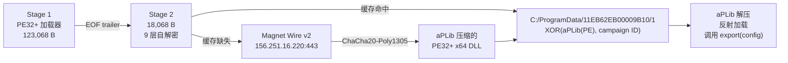

# Magnet Wire v2 Loader 分析

> 对一个 PE32+ x64 加载器及其 18,068 字节自解密 shellcode 的静态逆向分析。


> ⚠️ 包含分析报告、IOC 与检测规则。样本从未在本机运行，所有结论来自静态解析、Unicorn CPU 模拟和 Ghidra 反编译。
> !!!切记切记，病毒本体请在安全且隔离的环境内解压调试！！！

> **版本与检索说明（2026-10-30）**：原稿为作者上一版本地草稿，非他人报告；本版修正了其中的错误结论（原稿误判为 CobaltStrike Beacon、C2 写作 `74.121.14.228:8443`）。截至 2026-10-30，公开检索渠道未发现该样本的既有深度分析，本文公开其 stage-2 九层解密、`DMV2` 配置与 `Magnet Wire v2` 握手协议细节。样本首次提交微步在线时间为 2026-10-10，早于本文分析。

## TL;DR

- **Stage 1 只是壳**：外层 PE 从自身 EOF trailer（magic `BLT_PAYLOAD_001`）取出 18,068 B payload，`VirtualAlloc(RW) → memcpy → VirtualProtect(RWX) → CreateThread`。
- **Stage 2 是 9 层自解密 shellcode**：真实入口 `0x193`；解密 `DMV2` 配置，按哈希解析 43 个 API。
- **C2 是 `156.251.16.220:443`**，不是上一版草稿的 `74.121.14.228:8443`。
- **本地缓存优先**：`C:\ProgramData\11EB62EB00009B10\1`；缓存缺失时才走网络。
- **自研 `Magnet Wire v2` 协议**：自定义握手 + ChaCha20-Poly1305 命令帧，下载 aPLib 压缩的 PE32+ DLL，反射加载并调用导出。
- **不是 CobaltStrike**；本层也没有持久化和恶意反调试。

## 与上一版草稿的差异

| 上一版草稿结论 | 本次验证 |
|---|---|
| CobaltStrike Beacon 加载器 | ❌ 自研 `Magnet Wire v2` 加载器，无 CS 特征 |
| C2 `74.121.14.228:8443` | ❌ 实测 `156.251.16.220:443` |
| 约 104 KB 明文 Payload | ❌ 嵌入 payload 18,068 B；原始 EXE 120.18 KB |
| 反沙箱 / 反调试 | ⚠️ 本层没有；仅外层 CRT 的 `IsDebuggerPresent` |
| 内存执行绕过 | ✅ 反射加载 DLL，但磁盘有加密缓存，不是完全无文件 |

## 样本信息

| 项 | 值 |
|---|---|
| 原始样本 | `7.0_64_create_thread_safe (2).exe` |
| SHA-256 | `daef4a72268d193e0f1ea376461b3c337ee82547be2ede942310b702cd12148a` |
| MD5 | `fa2de9d30f1598981e7c21b0fe0cf3bf` |
| 大小 / 类型 | 123,068 B / PE32+ GUI x64 |
| 平台判定 | 微步在线：恶意，9/28 引擎，家族 `ShellcodeRunner` |
| 微步报告 | `S-261029-daef4a` |
| 嵌入 payload | 18,068 B，SHA-256 `609e4506e995e6312933badd3029648f3d1151c06a5dad4f84ee1e36816fb4a8` |
| 解密 shellcode | 18,068 B，SHA-256 `13a27e67aa6f3d95f529ca18ba0b7998d0d73e137ce9ad7955f1a00c7556b39e` |

## 执行链



## 分析要点

### 1. 外层加载器

- 文件末尾 40 字节 trailer：16 B magic `BLT_PAYLOAD_001\0`、version、flags、u64 offset、u64 size；
- 校验 `offset + 0x28 + size == fileSize`，payload 紧挨 trailer 存放；
- 读完 payload 后 `VirtualAlloc(RW)` → `memcpy` → `VirtualProtect(RWX)` → `CreateThread`，`WaitForSingleObject` 后 `VirtualFree`；
- 这是通用 shellcode 加载器模板，**不能**据此判定 CobaltStrike。

### 2. Stage-2：9 层解密与 DMV2 配置

- 9 个 head（`0x5` … `0x16e`）对应 9 个 stub（`0x4653` … `0x447e`），最内层循环 `0x191`，真实入口 **`0x193`**；
- 配置标记 `%@)!#!$` 位于 `0x42a7`，配置体从 `0x42ae` 开始，长度 `0x1d0`；
- magic `DMV2`、version 2，用 `0xc0deface` 驱动的 lowbias32 流异或解密；
- 关键字段：C2 IP `156.251.16.220`、端口 `443`、campaign ID `11EB62EB00009B10`、client ID `17e936cd21c167c3712e430c1308e267`、32 B PSK；
- 按哈希解析 43 个 API（kernel32 20、ntdll 2、ws2_32 16、user32 4、shell32 1），其中 user32 与部分 UDP API 本层未使用。

### 3. 网络：Magnet Wire v2

- `socket(AF_INET, SOCK_STREAM, IPPROTO_TCP)`，收发超时 5 s，收发缓冲 64 KiB，开启 keepalive；
- 三次握手：ClientHello `0x46` B → ServerHello `0x51` B → ClientProof `0x21` B；
- 7 个运行时拼接的 KDF label（`Magnet Wire v2 transcript` / `c2s key` / `s2c key` / `c2s nonce` / `s2c nonce` / `server proof` / `client proof`）；
- 命令帧：`[BE32 len][cmd][cmd2][0][0x02][BE64 seq][ChaCha20 密文][Poly1305 tag]`；
- 命令：`0x22` 注册、`0x1f` 下载头、`0x20` 分片、`0x21` 结束；CRC32 双向校验，总大小 ≤ 4 MiB；
- **密码学弱点**：PSK 静态嵌入、transcript 明文传输，拿到样本即可还原会话密钥，无前向保密。

### 4. 最终载荷：aPLib + 反射加载

- 下载数据是 `XOR(aPLib(PE32+ DLL), campaign ID)`，落盘到 `C:\ProgramData\<campaign>\1`；
- `aPLib` 解压到 1 MiB 缓冲，反射加载器校验 MZ / PE / machine `0x8664` / magic `0x20b`；
- 映射节、修 HIGHLOW/DIR64 重定位、填 IAT、调 TLS 回调、调 `DllMain(DLL_PROCESS_ATTACH)`；
- 按哈希 **`0x2ec07661`** 找导出并调用 `export(config_ptr)`，返回 0 视为成功；
- 成功后 `Sleep(60000)` 死循环保活；本层没有 Run 键、服务或计划任务。

## 完整报告

完整的中文分析见 [`REPORT.md`](REPORT.md)，包括：

- 执行摘要与阶段划分
- 外层 PE 与 EOF trailer 逐字段解析
- Stage-2 函数地图与主流程
- `DMV2` 配置算法与字段表
- API 哈希解析与 43 个导入清单
- 本地缓存 / 网络两条执行路径
- `Magnet Wire v2` 握手、KDF、AEAD、下载协议
- aPLib 与反射 PE 加载
- 密码学评估、勘误表、IOC、检测建议、局限

## IOC

| 类型 | 值 |
|---|---|
| 原始样本 SHA-256 | `daef4a72268d193e0f1ea376461b3c337ee82547be2ede942310b702cd12148a` |
| 原始样本 MD5 | `fa2de9d30f1598981e7c21b0fe0cf3bf` |
| C2 | `156.251.16.220:443`（TCP） |
| 缓存路径 | `C:\ProgramData\11EB62EB00009B10\1` |
| campaign ID | `11EB62EB00009B10` |
| 释放缓存 SHA-256 | `413ea0663a4f73da40221e2e397167e0fd59adb4e1879e0d86e6f00abaae1101` |
| PDB | `H:\window\tools\BinLoadTester\TestExeTemplates\out\x64\create_thread_safe_64.pdb` |
| 报告编号 | `S-261029-daef4a` |
| 协议指纹 | ClientHello 前 13 B：`00 00 00 46 00 00 00 02 01 00 02 00 02` |

完整清单见 [`iocs.csv`](iocs.csv)。

## 检测规则

[`magnetwire_v2.yar`](magnetwire_v2.yar) 包含三条规则：

1. `MagnetWire_v2_stage2_consts` — 匹配解密后的 stage-2（7 个常量中 4 个命中），适用于内存转储或解密后的 shellcode；
2. `MagnetWire_loader_pdb` — 匹配原始加载器的 PDB 路径；
3. `MagnetWire_v2_config_memory` — 匹配内存中解密后的 `DMV2` 配置（marker 与 magic 相距 7 字节）。

注意：`Magnet Wire v2 ...` label 是运行时用立即数拼出来的，**文件里没有明文字符串**，普通 `strings` / YARA 抓不到；需要按常量或内存特征匹配。

关键常量：`0xb1f48651`、`0x10001ab`、`0xc0deface`、`0x9e3779b9`、`0x7feb352d`、`0x846ca68b`、`0x2ec07661`。

## 仓库结构

```
.
├── README.md
├── REPORT.md          # 完整中文分析报告
├── iocs.csv           # IOC 清单
├── magnetwire_v2.yar  # YARA 规则
└── .gitignore         # 排除样本与分析工作区
```

## 分析方法

完整方法见 [`REPORT.md`](REPORT.md) 第 2 节。简述：

1. 解析外层 PE 的 EOF trailer 并切出加密 payload；
2. 用 Unicorn 2.1.4 做纯 CPU 模拟，跑完 9 层自解密（基址 `0x10000000`，不实现任何系统调用）；
3. 用 Ghidra 12.2 headless 反编译 41 个关键函数，Capstone 5.0.7 交叉校验；
4. 解密镜像的前 18,068 字节与微步公开的 18,068 字节内存转储**逐字节一致**。

样本从未原生执行。

## 免责声明

本项目仅用于防御性安全研究、检测规则编写与威胁情报共享。请勿在非隔离环境运行任何恶意样本。仓库不包含样本；如需复现，请自行在隔离沙箱中获取，并遵守当地法律法规。转载请注明本仓库链接。

## English Abstract

This repository documents a static reverse-engineering study of a PE32+ x64 loader and its 18,068-byte self-decrypting stage-2 shellcode. The outer loader extracts an embedded payload from an EOF trailer (magic `BLT_PAYLOAD_001`), maps it RWX and executes it in a new thread. The stage-2 shellcode decrypts a `DMV2` configuration, resolves 43 APIs by hash, and either loads a cached DLL from `C:\ProgramData\11EB62EB00009B10\1` or contacts `156.251.16.220:443` using a custom `Magnet Wire v2` handshake and a ChaCha20-Poly1305 command channel to download, aPLib-decompress and reflectively load a PE32+ DLL. The sample was never executed; all results come from static parsing, Unicorn CPU emulation and Ghidra decompilation. The original draft's CobaltStrike attribution and C2 were incorrect.
